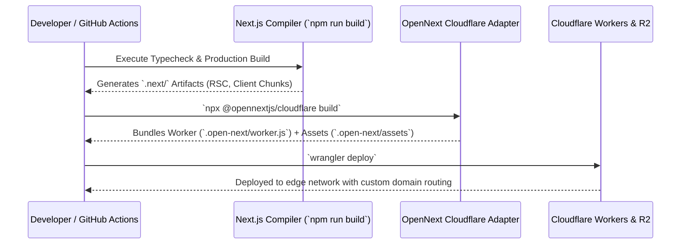

# Cloudflare Deployment Plan: Next.js 16 on Cloudflare Workers

**Project:** NewtronLabs / 3D Printing Wallah  
**Target Architecture:** Next.js 16 (App Router), React 19, TypeScript, Tailwind CSS v4  
**Edge Execution Platform:** Cloudflare Workers via OpenNext  
**Status:** Architectural Blueprint & Feasibility Audit  

---

## 1. Executive Summary

NewtronLabs requires a production-grade, highly responsive, and globally distributed deployment for its Next.js storefront and admin portal while maintaining a free-tier-first cost profile.

Deploying Next.js 16 App Router on Cloudflare Workers requires addressing two distinct execution models:
1. **Traditional Node.js Server:** Node.js long-running HTTP server with direct filesystem and native binary bindings.
2. **Cloudflare Workers (V8 Isolate):** Ephemeral, lightweight V8 worker runtime with standard Web APIs (`fetch`, `Request`, `Response`, `Web Crypto`) and Node.js compatibility layers (`nodejs_compat`).

This document audits the deployment tooling options, evaluates **OpenNext** vs **vinext**, analyzes Prisma ORM compatibility on the Edge, and defines the deployment pipeline.

---

## 2. Tooling Evaluation: OpenNext vs vinext

### Option A: OpenNext (`@opennextjs/cloudflare`) — Recommended

| Dimension | Assessment |
|---|---|
| **Maturity** | **Production-Ready & Actively Maintained** by Cloudflare and the OpenNext community. |
| **Next.js 16 / React 19 Support** | Native support. Built specifically to parse standard `.next` build artifacts into Cloudflare Worker bundles. |
| **App Router Support** | Complete support for Server Components (RSC), Server Actions, Route Handlers (`app/api/*`), dynamic SSR, and SSG pages. |
| **Asset Handling** | Automatically routes static files (`/public`, `_next/static`) to Cloudflare Assets / KV, leaving the worker to execute dynamic routes only. |
| **Code Changes Required** | **Zero UI or routing changes**. Only adds `wrangler.jsonc` and an OpenNext config file. |

### Option B: vinext — Not Recommended for Production

| Dimension | Assessment |
|---|---|
| **Maturity** | **Experimental / Beta**. |
| **Build Architecture** | Replaces the Next.js compiler with Vite. |
| **Risk Factor** | High risk of subtle rendering divergences, broken React 19 Server Actions, and Tailwind CSS v4 compiler incompatibilities. |
| **Recommendation** | **Reject for production.** Migrating the build toolchain introduces unnecessary failure modes. |

---

## 3. Runtime Compatibility Audit for Existing Codebase

### 3.1 Node.js APIs in Existing Code
- **`crypto`:** Currently handled by standard Web Crypto or Node crypto. Fully supported under Cloudflare's `compatibility_flags = ["nodejs_compat"]`.
- **`fs` / `path`:** The existing application does **not** rely on server filesystem persistence (except the audit/remediation scratch files). All data runs through TypeScript service interfaces.
- **Node `global` in `ordersStore`:** In `src/app/api/order-requests/route.ts`, an in-memory `global.__orderRequestsStore` is currently used. In Cloudflare Workers, global memory is scoped to individual isolates and not shared across edge nodes. **This reinforces the necessity of connecting Neon PostgreSQL before production launch.**

### 3.2 Prisma ORM on Cloudflare Workers
Traditional Prisma CLI generates a native binary query engine (`libquery_engine.so.node`), which **cannot run** in Cloudflare Workers V8 isolates.

**The Solution: Prisma Driver Adapters + Neon Serverless WebSockets**
```prisma
generator client {
  provider        = "prisma-client-js"
  previewFeatures = ["driverAdapters"]
}

datasource db {
  provider = "postgresql"
  url      = env("DATABASE_URL")
}
```
Client instantiation in Worker context:
```typescript
import { Pool } from "@neondatabase/serverless";
import { PrismaNeon } from "@prisma/adapter-neon";
import { PrismaClient } from "@prisma/client";

const connectionString = process.env.DATABASE_URL!;
const pool = new Pool({ connectionString });
const adapter = new PrismaNeon(pool);
export const prisma = new PrismaClient({ adapter });
```
This architecture bypasses native binaries completely by utilizing HTTP / WebSocket communication over `@neondatabase/serverless`.

---

## 4. Configuration Specification (`wrangler.jsonc`)

```jsonc
{
  "$schema": "node_modules/wrangler/config-schema.json",
  "name": "newtronlabs-storefront",
  "main": ".open-next/worker.js",
  "compatibility_date": "2026-11-20",
  "compatibility_flags": [
    "nodejs_compat"
  ],
  "assets": {
    "directory": ".open-next/assets",
    "binding": "ASSETS"
  },
  "vars": {
    "NODE_ENV": "production",
    "NEXT_PUBLIC_APP_URL": "https://3dprintingwallah.com"
  },
  "r2_buckets": [
    {
      "binding": "R2_MODELS_BUCKET",
      "bucket_name": "newtronlabs-models-private"
    }
  ]
}
```

---

## 5. Build & Deployment Sequence



### Steps:
1. **Build Step:** `npx @opennextjs/cloudflare build`
2. **Preview Step:** `npx wrangler dev` (Runs locally in Miniflare worker environment)
3. **Deploy Step:** `npx wrangler deploy`

---

## 6. Pre-Deployment Validation Checklist

- [ ] All dynamic routes handle edge request streaming without hanging.
- [ ] Database client uses `@prisma/adapter-neon` over `@neondatabase/serverless`.
- [ ] No direct references to local filesystem in API routes.
- [ ] R2 bindings defined in `wrangler.jsonc`.
- [ ] Custom domain DNS managed via Cloudflare CDN with SSL/TLS Full (Strict).
