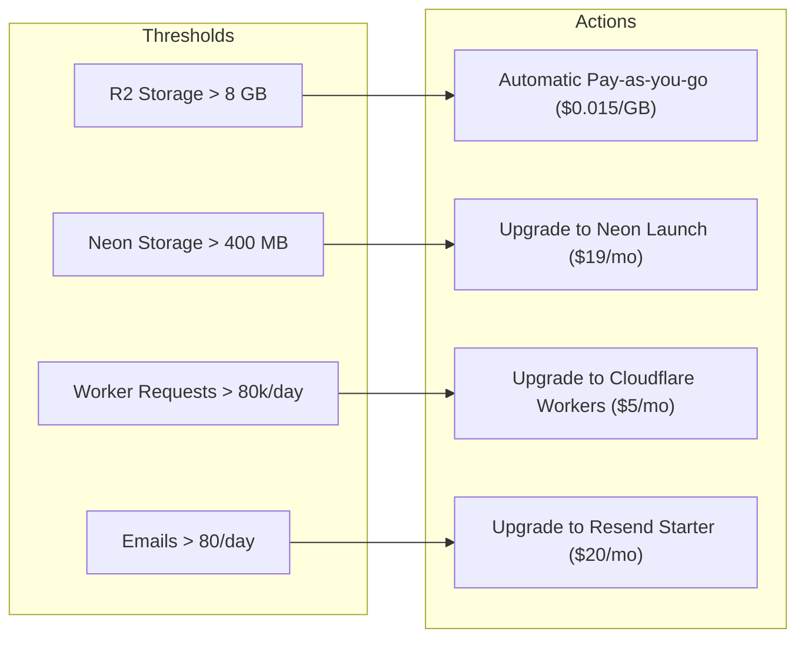

# Free-Tier Cost Model & Upgrade Roadmap

**Project:** NewtronLabs / 3D Printing Wallah  
**Core Strategy:** Zero-Cost Initial Launch with Independent Service Scalability  
**Status:** Cost Analysis & Capacity Planning  

---

## 1. Free-Tier Quota Matrix

| Infrastructure Provider | Free Quota | Monthly Limit | What Exceeding Looks Like |
|---|---|---|---|
| **Cloudflare Workers** | 100,000 requests / day | ~3,000,000 requests / mo | HTTP 429 Too Many Requests |
| **Cloudflare R2** | 10 GB storage | 1M Class A ops (upload/list), 10M Class B ops (read) | Overages billed at $0.015/GB-mo (Zero egress fee) |
| **Neon PostgreSQL** | 0.5 GiB storage | 191 compute hours / mo (Auto-suspends after 5m idle) | Database read-only or connection throttled |
| **Resend (Email)** | 100 emails / day | 3,000 emails / mo | Daily delivery pauses until midnight UTC |

---

## 2. Projected Monthly Operating Costs Across Growth Stages

### Stage 1: Launch & MVP (Current to Month 3)
- **Traffic:** ~5,000 monthly page views
- **Order Requests:** 50–150 / month
- **CAD File Uploads:** 30–80 files / month (~2.5 GB total storage)
- **Infrastructure Cost Breakdown:**
  - Cloudflare Workers: **$0.00** (Well within 100K daily limit)
  - Cloudflare R2: **$0.00** (2.5 GB of 10 GB free)
  - Neon PostgreSQL: **$0.00** (~25 MB database size, within 0.5 GiB)
  - Resend: **$0.00** (~300 emails, within 3,000 free)
  - **Total Monthly Cost: $0.00 / month**

---

### Stage 2: Workshop Growth (Month 4 to Month 12)
- **Traffic:** ~30,000 monthly page views
- **Order Requests:** 500–1,000 / month
- **CAD File Uploads:** 300–500 files / month (~15 GB cumulative storage)
- **Infrastructure Cost Breakdown:**
  - Cloudflare Workers: **$0.00** (~30K requests is ~1K/day, far below 100K/day)
  - Cloudflare R2: **$0.08 / month** (5 GB over free tier @ $0.015/GB)
  - Neon PostgreSQL: **$19.00 / month** (Upgrade to Neon Launch Plan for 10 GB storage & continuous compute)
  - Resend: **$0.00** (Customer + admin alerts = ~2,000 emails, within 3,000 free)
  - **Total Monthly Cost: ~$19.08 / month**

---

### Stage 3: Scale & National Reach (Year 2+)
- **Traffic:** ~150,000 monthly page views
- **Order Requests:** 3,000–5,000 / month
- **CAD File Uploads:** 2,000 files / month (~60 GB cumulative storage)
- **Infrastructure Cost Breakdown:**
  - Cloudflare Workers Paid: **$5.00 / month** (Includes 10M requests)
  - Cloudflare R2: **$0.75 / month** (50 GB over free tier)
  - Neon Scale Plan: **$69.00 / month** (Dedicated compute, 50 GB storage, PITR)
  - Resend Pro: **$20.00 / month** (50,000 emails/month)
  - **Total Monthly Cost: ~$94.75 / month**

---

## 3. Decoupled Upgrade Triggers

Each infrastructure component can be scaled independently without architectural rewrites:

### Early Warning Alert Strategy:
1. **Database:** Neon automated webhook alerts at 80% of 0.5 GiB (400 MB).
2. **Storage:** Cloudflare R2 billing notification at $1.00 spend threshold.
3. **Email:** Daily monitor logs alert when reaching 75 sent emails in a 24-hour cycle.
