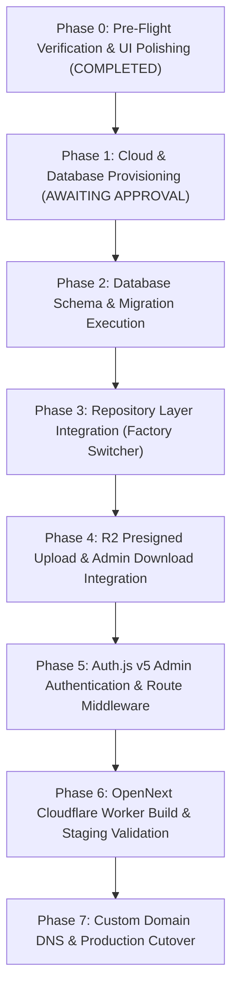

# Implementation Roadmap & Verification Checklist

**Project:** NewtronLabs / 3D Printing Wallah  
**Target Stack:** Next.js 16, Cloudflare Workers, Cloudflare R2, Neon PostgreSQL, Prisma ORM  
**Status:** Pre-Implementation Phase Gate  
**Execution Rule:** Analysis and documentation phase complete. Do NOT execute destructive actions or connect paid credentials until explicit user authorization is granted.  

---

## 1. Phase Gate Overview



---

## 2. Detailed Checklist by Phase

### Phase 0: Pre-Flight Verification & Storefront Polish (Completed)
- [x] Independently audited all 13 remediation areas (`POST_REMEDIATION_VERIFICATION.md`).
- [x] Removed non-required Storefront header badge (`STORE CATALOGUE`) and item count label from `ShopHeader`.
- [x] Re-pointed footer CTA `Start a conversation` directly to `/contact`.
- [x] Verified zero TypeScript errors (`tsc --noEmit`) and successful clean build.

---

### Phase 1: Cloud & Database Provisioning (Awaiting Approval)
- [ ] Create free Neon PostgreSQL project in AWS `ap-south-1` (Mumbai) or `us-east-2`.
- [ ] Record `DATABASE_URL` (pooled connection) and `DIRECT_URL` (direct connection).
- [ ] Create private Cloudflare R2 bucket: `newtronlabs-models-private`.
- [ ] Configure R2 CORS policy for `https://3dprintingwallah.com` and local dev.
- [ ] Generate R2 API Tokens with Object Read & Write permissions.
- [ ] Generate `AUTH_SECRET` using `openssl rand -hex 32`.

---

### Phase 2: Schema Migration & Database Initialization
- [ ] Install Prisma dependencies:
  ```bash
  npm install @prisma/client @prisma/adapter-neon @neondatabase/serverless
  npm install -D prisma
  ```
- [ ] Place validated `schema.prisma` into `prisma/schema.prisma`.
- [ ] Execute initial migration:
  ```bash
  npx prisma migrate dev --name init_newtronlabs_schema
  ```
- [ ] Execute database seed script:
  - Migrate all 10 products from `src/data/products.ts`.
  - Migrate all 7 categories from `INITIAL_DEMO_CATEGORIES`.
  - Create initial default Admin User with secure Argon2id password hash.

---

### Phase 3: Repository Layer Integration (Factory Switcher)
- [ ] Implement `PrismaProductService` implementing `IProductService`.
- [ ] Implement `PrismaOrderService` implementing `IOrderService`.
- [ ] Implement `PrismaEnquiryService` implementing `IEnquiryService`.
- [ ] Implement `PrismaInventoryService` implementing `IInventoryService`.
- [ ] Activate Factory Switcher pattern in all services (checks `DATABASE_URL`).
- [ ] Verify local storefront and admin panel successfully fetch and mutate data from Neon PostgreSQL.

---

### Phase 4: R2 Presigned Upload & Admin Download Integration
- [ ] Install AWS S3 SDK packages:
  ```bash
  npm install @aws-sdk/client-s3 @aws-sdk/s3-request-presigner
  ```
- [ ] Implement `POST /api/custom-prints/upload-url` generating 15-minute presigned PUT URLs.
- [ ] Update client-side upload handler in `/custom/3d-printing` to upload binary stream directly to R2.
- [ ] Implement `GET /api/admin/custom-prints/[id]/download` generating 5-minute presigned GET URLs for authorized staff.

---

### Phase 5: Auth.js v5 Admin Authentication & Route Middleware
- [ ] Install Auth.js dependencies:
  ```bash
  npm install next-auth@beta @auth/prisma-adapter
  ```
- [ ] Create `src/auth.ts` with Credentials Provider and role verification.
- [ ] Create `src/middleware.ts` guarding `/admin/*` and `/api/admin/*`.
- [ ] Connect `src/app/admin/login/page.tsx` to Auth.js `signIn("credentials")`.

---

### Phase 6: Cloudflare Worker Build & OpenNext Testing
- [ ] Install OpenNext Cloudflare adapter:
  ```bash
  npm install -D @opennextjs/cloudflare wrangler
  ```
- [ ] Create `wrangler.jsonc` with `nodejs_compat` and R2 bucket bindings.
- [ ] Test edge build locally:
  ```bash
  npx @opennextjs/cloudflare build
  npx wrangler dev
  ```
- [ ] Verify edge streaming, RSC rendering, and API response latency.

---

### Phase 7: Production Cutover & Monitoring
- [ ] Bind production custom domain in Cloudflare Dashboard: `3dprintingwallah.com`.
- [ ] Deploy worker: `npx wrangler deploy`.
- [ ] Perform end-to-end smoke test:
  1. Browse shop catalog & filter by category.
  2. Add item to cart and submit order request.
  3. Verify order record in Neon database.
  4. Submit custom 3D model on `/custom/3d-printing` and verify R2 storage.
  5. Sign into `/admin`, verify order review, and test presigned CAD download.
  6. Submit contact enquiry on `/contact` and verify admin inbox.

---

## 3. Rollback Strategy

1. **Database Rollback:** Neon provides instant point-in-time recovery and branch reset. If a migration encounters issues, the database can be reset to a pre-migration branch state within seconds.
2. **Application Rollback:** Cloudflare Workers maintains versioned releases. Any broken deployment can be instantly rolled back via `wrangler rollback` or the Cloudflare Dashboard with zero downtime.
3. **Local Development Fallback:** The mock services (`MockProductService`, `MockInventoryService`) remain fully intact in the repository. Unsetting `DATABASE_URL` instantly reverts the app to offline prototype mode.
