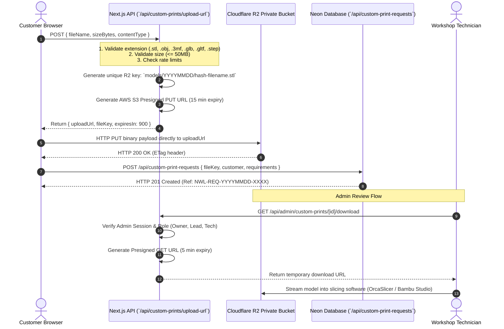

# Cloudflare R2 Storage Architecture: 3D CAD Models & Asset Pipeline

**Project:** NewtronLabs / 3D Printing Wallah  
**Object Storage Service:** Cloudflare R2 (S3-Compatible)  
**Security Model:** Zero-Knowledge Client, Private Buckets, Server-Authorized Presigned URLs  
**Status:** Architectural Blueprint & Implementation Specification  

---

## 1. Architectural Principles

1. **Keep Binary Bytes Out of PostgreSQL:**
   Relational databases perform poorly when storing large binary files (blobs). R2 stores the raw file bytes; Neon PostgreSQL stores metadata only (R2 key, file size, MIME type, SHA-256 hash).
2. **Direct Browser-to-R2 Uploads:**
   Uploading large 3D files (up to 50MB) through Next.js serverless functions would risk hitting server request body size limits, memory saturation, and execution timeouts. Instead, the browser uploads directly to R2 using a temporary, presigned PUT URL.
3. **Zero Secret Exposure:**
   R2 access keys (`R2_ACCESS_KEY_ID`, `R2_SECRET_ACCESS_KEY`) remain strictly on the server or Cloudflare Worker binding. The browser receives only a scoped, temporary URL valid for 15 minutes.
4. **Private by Default:**
   Customer CAD models, intellectual property, and custom printing files are stored in a private bucket with public access disabled. Staff access files exclusively via authenticated, short-lived presigned GET URLs.

---

## 2. Bucket Topology

| Bucket Name | Access Level | Purpose | Formats |
|---|---|---|---|
| `newtronlabs-models-private` | **Private (No Public URL)** | Customer CAD 3D models & print requests | `.stl`, `.obj`, `.3mf`, `.step`, `.glb`, `.gltf` |
| `newtronlabs-assets-public` | **Public via CDN Custom Domain** | Storefront product images, workshop photos | `.webp`, `.png`, `.jpg`, `.svg` |

---

## 3. Presigned Upload Sequence



---

## 4. Production Storage Adapter Blueprint

```typescript
// src/services/storage/r2-storage-adapter.ts
import { S3Client, PutObjectCommand, GetObjectCommand } from "@aws-sdk/client-s3";
import { getSignedUrl } from "@aws-sdk/s3-request-presigner";

export const ALLOWED_EXTENSIONS = [".stl", ".obj", ".3mf", ".step", ".glb", ".gltf"] as const;
export const MAX_FILE_SIZE_BYTES = 50 * 1024 * 1024; // 50 MB

export class CloudflareR2Service {
  private client: S3Client;
  private bucket: string;

  constructor() {
    this.bucket = process.env.R2_BUCKET_NAME || "newtronlabs-models-private";
    this.client = new S3Client({
      region: "auto",
      endpoint: `https://${process.env.R2_ACCOUNT_ID}.r2.cloudflarestorage.com`,
      credentials: {
        accessKeyId: process.env.R2_ACCESS_KEY_ID!,
        secretAccessKey: process.env.R2_SECRET_ACCESS_KEY!,
      },
    });
  }

  /**
   * Generates a single-use presigned PUT URL for browser direct upload.
   */
  async createPresignedUploadUrl(
    fileName: string,
    fileSizeBytes: number,
    contentType: string
  ): Promise<{ uploadUrl: string; fileKey: string; expiresIn: number }> {
    const ext = fileName.slice(fileName.lastIndexOf(".")).toLowerCase();
    if (!ALLOWED_EXTENSIONS.includes(ext as any)) {
      throw new Error(`Unsupported file type: "${ext}". Permitted: ${ALLOWED_EXTENSIONS.join(", ")}`);
    }

    if (fileSizeBytes > MAX_FILE_SIZE_BYTES) {
      throw new Error(`File size exceeds 50MB ceiling.`);
    }

    const dateFolder = new Date().toISOString().slice(0, 10).replace(/-/g, "");
    const randomSalt = Math.random().toString(36).substring(2, 8);
    const sanitizedName = fileName.replace(/[^a-zA-Z0-9._-]/g, "_");
    const fileKey = `models/${dateFolder}/${Date.now()}-${randomSalt}-${sanitizedName}`;

    const command = new PutObjectCommand({
      Bucket: this.bucket,
      Key: fileKey,
      ContentType: contentType,
      ContentLength: fileSizeBytes,
    });

    const uploadUrl = await getSignedUrl(this.client, command, { expiresIn: 900 }); // 15 mins

    return { uploadUrl, fileKey, expiresIn: 900 };
  }

  /**
   * Generates a short-lived presigned GET URL for technician inspection.
   */
  async createPresignedDownloadUrl(fileKey: string): Promise<string> {
    const command = new GetObjectCommand({
      Bucket: this.bucket,
      Key: fileKey,
    });
    return getSignedUrl(this.client, command, { expiresIn: 300 }); // 5 mins
  }
}
```

---

## 5. R2 Bucket CORS & Lifecycle Configuration

### CORS Policy for `newtronlabs-models-private`:
```json
[
  {
    "AllowedOrigins": [
      "https://3dprintingwallah.com",
      "https://*.pages.dev",
      "http://localhost:3000"
    ],
    "AllowedMethods": ["PUT", "GET"],
    "AllowedHeaders": [
      "Content-Type",
      "Content-Length",
      "x-amz-*"
    ],
    "ExposeHeaders": ["ETag"],
    "MaxAgeSeconds": 3600
  }
]
```

### Lifecycle Rules:
- **Abandoned Uploads:** Purge unreferenced files in `models/` with age > 7 days where no corresponding database record exists in `model_files`.
- **Completed Orders:** Move files to cold archive storage after 90 days.
